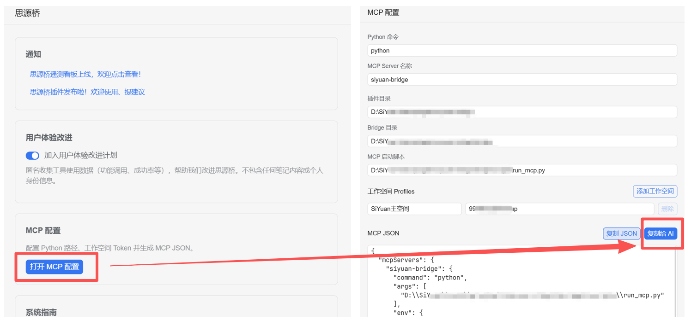
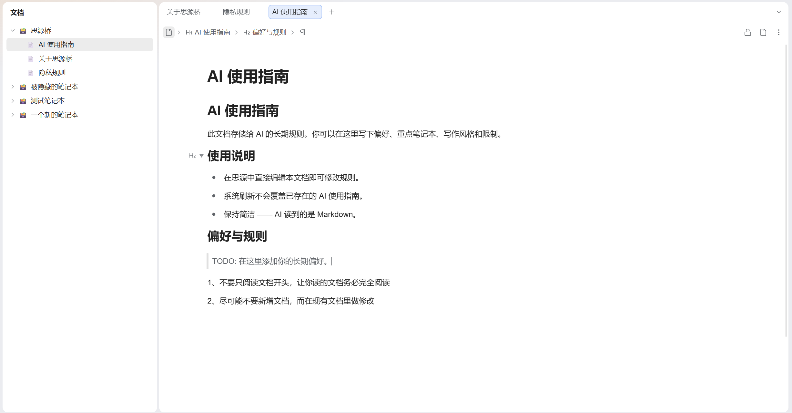
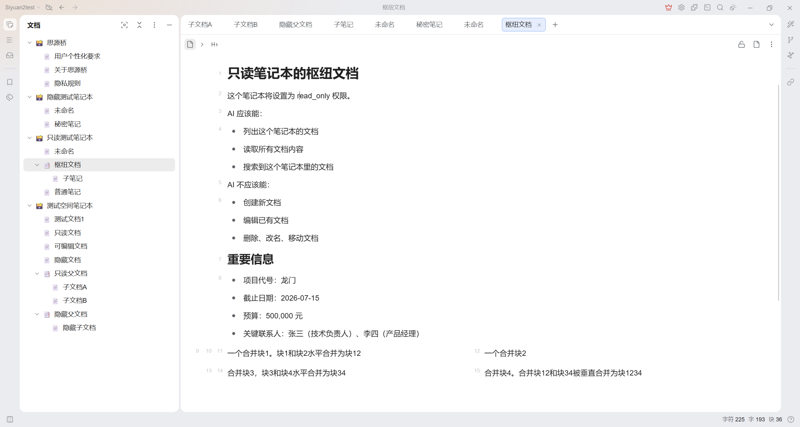
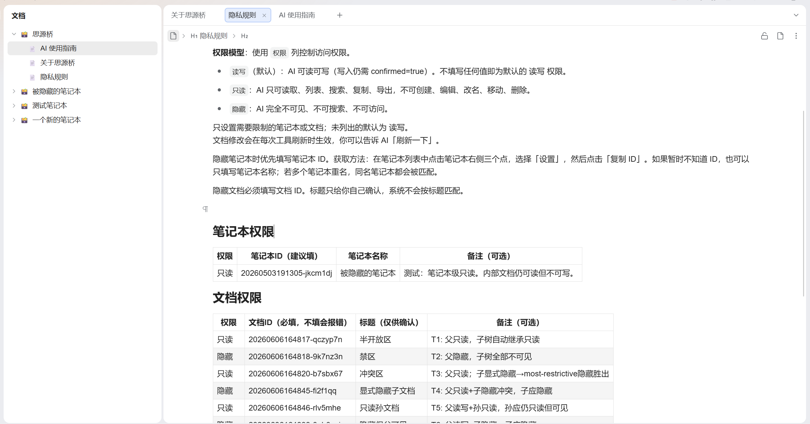
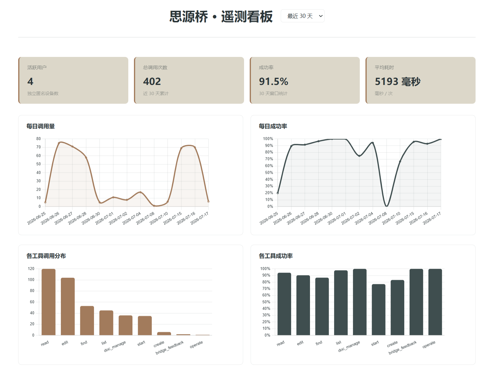

<h1 align="center">SiYuan Bridge</h1>

Connect AI to your SiYuan notes, deeply optimized for knowledge-base reading and editing, built for stability, reliability, and peace of mind. Supports flexible privacy and personalization settings.

## Highlights

- Understand complex documents: read mixed text and images, embedded block content, and more in one pass, so what AI sees matches what you see, instead of reading only the text and missing the images.
- Flexible editing: locate by block number and ID; headings, tables, lists, code blocks, and flowcharts can all be edited. Large tables and long lists get dedicated optimization.
- Clipping and inbox: save web links as SiYuan documents, and read the cloud inbox and move items into notebooks.
- Privacy control: three permission levels, read-write / read-only / hidden, inherited along the document tree, with privacy rules isolated from AI.
- Safety net: automatic snapshot before editing, reference checks before deletion or rewrite, and breaking references refused by default.
- Rules in SiYuan: preferences, index, and privacy rules are all SiYuan documents, viewable and editable directly, and synced with the workspace.

## Core Philosophy

### Adapt to SiYuan's block structure

SiYuan organizes notes internally by blocks: a paragraph, a table, a list item are each a block, and the underlying APIs are designed block by block. SiYuan Bridge follows this block structure instead of copying plain-text editing. It naturally connects the underlying block structure with top-level document paragraphs, so AI still sees complete documents and a few simple actions. This avoids repeated failures in text matching while preserving SiYuan's native block semantics.

### Manage AI with SiYuan documents

All behavioral rules AI must follow live in real SiYuan documents rather than local config files. User preferences, the workspace index, and privacy rules are all documents you can open, view, and edit directly in SiYuan. They are bound to the current workspace and sync across devices; once you change them in SiYuan, they take effect, with no need to go through plugin settings or local files.

### Consolidate the tool surface

SiYuan Bridge offers only a small set of lean tools, designed around the programming actions AI excels at: list files, search files, read files, edit files, create files. Each task has as few approaches as possible, reducing AI's choice burden.

### Safety bottom line

Safety is not left to reminding AI to behave; it is written into the tools' default flow. Backlink reference protection checks whether a block is referenced before deletion or rewrite; document-level privacy rules filter data before it is returned; an automatic SiYuan workspace snapshot is created before editing. All of this runs silently in the background, nearly invisible to AI, and saves you from manual checks every time.

## What you can ask AI to do

- "Find my notes on procrastination and attention, identify recurring ideas, write a summary, and cite specific passages from the original documents."
- "Organize my course notes into a review framework with source references."
- "Clip this WeChat article (with its URL) into my knowledge base and explain the architecture diagrams in it."
- "Section 3 of this article is confusing; keep the meaning but reorder the paragraphs."
- "Update the dates in my travel itinerary and add a budget column."
- "Insert the photos and itinerary files from my computer into this travel record."
- "Create a new project notebook, organize these PDFs into documents, and reclassify them."
- "See what's in my cloud inbox and move the ones I need into my project notebook."

## Installation and getting started

Using SiYuan Bridge requires desktop SiYuan Notes (minimum 3.3.0, latest recommended) and Python 3.11 or higher. Some plugin features use a small number of third-party dependencies, which are installed automatically when you install the plugin.

1. Search for "SiYuan Bridge" in the SiYuan marketplace and install the plugin.
2. Open the plugin settings and save the current workspace token on the MCP configuration page (usually detected and saved automatically).
3. Copy the generated MCP configuration and send it to your AI Agent to register it in the format its platform requires.
4. Restart the AI Agent, then say: "Help me find a topic in my notes."

If you use cloud sync, see "FAQ" below.

When the plugin is first enabled, SiYuan Bridge creates a notebook named "SiYuan Bridge" in the current workspace, containing 4 documents:
- User Preferences: the instructions you want AI to follow, e.g. "show me a draft before modifying a document, and wait for my confirmation before writing"
- Workspace Index: what's in your SiYuan notes and where. AI can help write it, or you can write it yourself
- Privacy Rules: if you want special permissions for certain documents/notebooks, copy their IDs into the document. No extra restrictions by default. Privacy rules are managed only by the user and isolated from AI.
- About SiYuan Bridge: a brief introduction

These documents are all stored in SiYuan and sync with the workspace.

SiYuan Bridge shows live block numbers in the left margin of the document by default, so the block numbers AI sees match what you see, making it easy to point to a specific paragraph. They recalculate automatically when the document structure changes.

Right-click a document in the document tree and choose "Copy → Copy Full Path (SiYuan Bridge)" to copy a path including the notebook name (e.g. `/Investment Research/Company Research/Example Company`) and paste it directly to AI for document targeting. This menu sits below the native "Copy readable path"; the plugin panel's "Copy full path" toggle is on by default, and turning it off hides the menu item.

Image components are downloaded automatically into SiYuan Bridge's own directory and reused if already present, with no manual installation. The default image budget is 9 MiB (adjustable in "Advanced Settings"), and every response stays within the 10 MB transport limit; original image groups that don't fit are reported with their path preserved rather than sent as partial slices. The image toggle is off by default and the model you use needs to support image input; AI can also request images per call with include_images. Original attachments are never modified.

## How SiYuan Bridge protects your notes

AI is fast, but a single wrong operation can affect a lot of content. SiYuan Bridge builds confirmation, snapshots, reference checks, and privacy permissions into the actual workflow.

Before creating, editing, moving, copying, or deleting content, explicit user approval is required. Before any write, SiYuan Bridge creates a SiYuan workspace snapshot. If the result isn't what you expected, you can restore manually from SiYuan's data repository. SiYuan Bridge never auto-rolls back, to avoid a recovery operation overwriting later legitimate changes.

When deleting documents, rewriting existing content, or merging paragraphs, original document IDs and block IDs may disappear. If other notes still reference them, SiYuan Bridge stops by default and lists the reference sources you may view. Only after you've reviewed the impact and explicitly allowed it can AI break these references. You can also proactively check references at any time, without waiting until something is about to be deleted.

Privacy rules are maintained directly in SiYuan documents. Notebooks or documents can be set to read-write, read-only, or hidden, with permissions inherited down the document tree. Hidden content never appears in listings, search, reading, or operation results; read-only content can be queried and organized but not modified. The privacy rules document itself is isolated from AI, which cannot read, search, or edit it.

Closing a notebook only means it's not currently in use, not that it's hidden. During search and reading, SiYuan Bridge temporarily opens closed notebooks as needed and restores their closed state afterward. If you don't want AI to access certain content, set it to hidden in the privacy rules.

## Tool details

SiYuan Bridge wraps complex block handling inside the tools and exposes only nine tools. Each tool handles one class of decisions, and the division of parameters is written into the tool descriptions, so the same thing has as few optimal approaches as possible and AI gets it right the first time.

### siyuan_start

The tool that must be called first at session start. It aggregates runtime status, the workspace index, user preferences, and built-in guides into a startup packet delivered to AI.

### siyuan_read

The document reading tool. It provides the document outline and body together, paginates long documents by block window without cutting mid-sentence, and inlines images so mixed text-and-image documents aren't read as text only. Embedded blocks are also expanded, so what you see and what AI sees stay as consistent as possible. Before editing, it also provides block numbers and block IDs for AI to locate the target. Large and long images are automatically processed in the background into AI-friendly forms.

### siyuan_create

The document creation tool. It writes directly, imports a local md file, or clips from an external URL (most sites supported, with dedicated support for WeChat articles). Same-name documents are rejected by default; you can also choose to clear and rewrite while preserving the document ID, or create another document with the same name.

### siyuan_edit

The body editing tool based on blocks. It replaces whole blocks with excellent compatibility; headings, tables, lists, and code blocks can all be edited. Large tables and long lists get dedicated optimization to avoid collateral damage. It also supports inserting local images, files, and folders at specified positions in a document.

### siyuan_doc_manage

The document-tree management tool. It manages regular local notebooks and the SiYuan inbox (you can move inbox documents into other notebooks for further processing).

### siyuan_list

The document-tree listing tool. It lists notebooks or the direct child documents under a path, with effective permissions, word count, and update time.

### siyuan_find

The knowledge-base search tool. It supports native query, regex, and SQL modes, and filters results through privacy rules before returning them. During search it temporarily opens closed notebooks and restores them afterward, so a closed notebook doesn't cause misses.

### siyuan_operate

Supports querying a document's forward and backward references, reading built-in guides, and triggering SiYuan's native sync.

### siyuan_bridge_feedback

A tool for submitting bugs, feature requests, or ideas through the conversation. It needs no confirmation and doesn't modify SiYuan content. You can tell AI "report the scenario that just failed to SiYuan Bridge's developer", and the feedback goes to the developer's backend (suggestions welcome!)

## Currently not supported

- Database editing: databases can be read as plain tables, but editing is not yet supported.
- Flashcards, block styling, and similar features.
- Deleting an entire notebook: currently only notebook creation is supported; deletion applies to documents and their sub-documents.
- Mobile: SiYuan Bridge runs through a local Python program and is currently desktop-only.

## FAQ

- Do you support multiple SiYuan workspaces? Yes. Install the plugin in your main workspace, then manually add tokens for other workspaces in the plugin settings. User preferences, the workspace index, and privacy rules are stored separately in each workspace and switch automatically. Only one workspace can be active at a time. When switching, open the target workspace and close the others, then close and restart the target workspace. SiYuan assigns a fixed port to the first workspace started and random ports to later ones, which SiYuan Bridge cannot reliably detect. So there's no need to register the same MCP separately in every workspace, or AI will see duplicate tools.

- I have SiYuan on two computers, how do I use it? The plugin itself syncs with the workspace, but the MCP config's startup script must use the current computer's absolute path and matching token. The plugin automatically detects the current device's path and token and generates the corresponding MCP config. Just open the plugin settings on each computer and copy the MCP config it regenerates to AI.

- SiYuan isn't started, what should I do? This plugin uses SiYuan's default port 6806, but in some cases the port may be occupied. Close all running SiYuan Notes and reopen.

- Is there an order between starting SiYuan and starting MCP? No. Once MCP is registered, AI Agent can discover the tools even if SiYuan isn't running. Reading or modifying notes requires SiYuan to be started first, as an explicit authorization step. The tool will prompt to open SiYuan (and tell AI not to try on its own). Some Agents may lose registered MCP connections after proxy or VPN state changes; in that case you may need to restart the Agent.

- After setup, AI still can't see the tools? Confirm you copied the generated MCP config into the correct AI client and restarted the client. Different AI Agents use slightly different MCP registration formats; the plugin currently generates Claude Code format; you can also hand the config to AI and ask it to convert to the format your platform needs.

- What is the user experience improvement program? It anonymously collects SiYuan Bridge tool call success rates to find poorly designed tools. Off by default. When on, it records only version, tool name, execution time, success, and error type; it does not upload note content, search content, or conversations, and collects no specific note info or AI chat history. Anonymous stats can be viewed on the public dashboard.

- Windows marketplace update reports `rename ... Access is denied`? Older SiYuan Bridge MCP used the plugin directory as its working directory, which could block marketplace replacement when running in the background. Before the first upgrade to the fixed version, stop all MCP processes connected to this plugin (including AI client background services), keep SiYuan open, and retry the update; don't delete plugin data or bulk-kill Python processes. The fixed version no longer uses the plugin directory as its working directory, so existing MCP registrations and configs need no changes. Pause tool calls during the upgrade, then restart the SiYuan Bridge MCP process after the update to load the new code; starting a new conversation alone may not restart the process. If the error persists, check for other programs holding the directory or directory permissions.

  

- Content disappeared, conflicts, or SiYuan crashed after a change? A common cause is two computers opening the same workspace with auto cloud sync on. Set sync to manual, or sync only at startup and shutdown. You can ask AI to call SiYuan's built-in sync when needed. SiYuan Bridge first follows the native flow to check config and sync source, and only asks you to decide upload/download when the native flow requires a choice; it doesn't preset a direction; regular sync and native empty-cloud auto-upload follow the native flow. After a timeout or connection failure it doesn't auto-retry, and won't claim sync succeeded based only on HTTP success.

- Why wasn't a new snapshot created before a change? Auto cloud sync also creates snapshots. During sync SiYuan may judge there's no new data and skip the snapshot SiYuan Bridge requested. Set auto sync to manual, or sync only at startup and shutdown.

- AI-written #tags# became plain text? Whether SiYuan parses paired `#tag#` into tags depends on editor settings. Open SiYuan "Settings → Editor → Markdown inline syntax" and enable "#foo#" (tag syntax). Once on, `#tag#` written by AI becomes a clickable real tag and appears in the tag panel; when off, all Markdown writes, including SiYuan's native APIs, won't parse tags and they become plain text.

- Do snapshots keep growing? SiYuan has built-in snapshot cleanup, usually keeping two per day and deleting after 180 days. But auto cleanup requires cloud sync to trigger. For a purely local workspace without cloud sync, periodically clean up via "Settings → Data Repository → Cleanup".

- How can SiYuan Bridge manage documents? It can create notebooks and documents, and rename, move, copy, export, or delete documents. Rename, copy, and export apply only to the current document; move and delete apply to the entire document subtree, i.e. the document and all its descendants. Deleting an entire notebook is not currently offered.

- How do I view a document's forward and backward references? Tell AI "which blocks does this document reference", corresponding to `siyuan_operate(action="check_forward_references")`, which shows referenced blocks grouped by target document; asking "which blocks reference this document" uses `action="check_backward_references"`, showing referencing blocks grouped by source document. Both count internal references and recursively aggregate sub-documents. By default each shows 10 visible peer/sub-documents; use `limit="none"` to see all, and the display limit doesn't affect total counts. Hidden peers only count relationships, without exposing paths, IDs, content, or document counts.

- Will deletion or rewrite break block references? Any operation that makes document IDs or block IDs disappear first checks whether those contents are still referenced by other notes. If references exist, SiYuan Bridge refuses by default and shows the viewable reference sources. Only after you understand the impact and explicitly agree can AI break these references.

## Community and feedback

If you run into problems or have ideas, tell AI "submit feedback", or visit [GitHub](https://github.com/alone-tree/siyuan-bridge) to file an issue.

For more introductions and discussions, see the community post on [链滴](https://ld246.com/article/1780911033554).

If SiYuan Bridge helps you, feel free to show your support!

---

Apache-2.0 License
