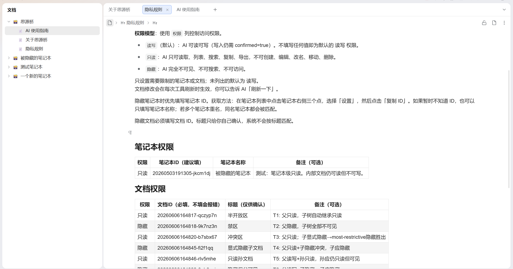
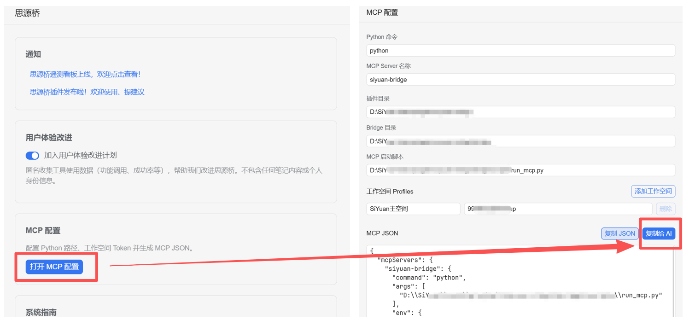
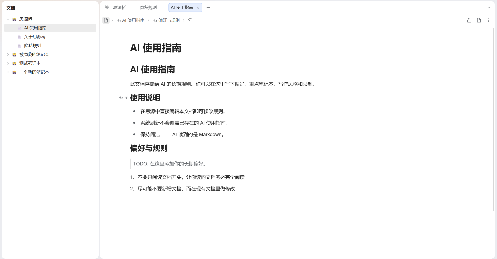
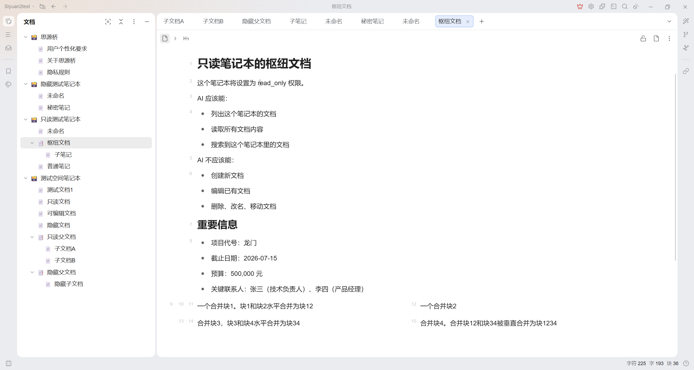

<h1 align="center">思源桥</h1>

让AI接入你的思源笔记，针对知识库阅读编辑场景深度优化。支持灵活的隐私和个性化要求设置。

思源桥走小而精的路线，不追求覆盖思源的全部功能，只把知识库高频场景做扎实，以稳定可靠易用为核心目标。它解决的是知识库场景下的常见问题：思源里图文混排的复杂资料，AI常常看不全、看不清；文档积累到几百上千篇后，AI也不知道什么文档在哪。

## 亮点

- 小而精：只做知识库高频场景，不追求功能全覆盖，稳定可靠易用。
- 读懂图文：长文分块不截断句子，截图和图表随正文一起读。
- 块级编辑：按块序号和ID定位，标题、表格、列表、代码块都能改。
- 文档管理：建笔记本，文档改名、移动、复制、导出、删除。
- 剪藏与收集箱：把网页存成思源文档，云端收集箱只读查看并移出。
- 隐私可控：读写、只读、隐藏三档权限，按文档树继承，隐私规则对AI隔离。
- 安全兜底：编辑前自动快照，删除或重写前检查引用，默认拒绝破坏引用。
- 规则放思源：偏好、索引、隐私规则都是思源文档，可直接查看修改，随工作空间同步。

## 核心理念

### 适配思源块结构

思源笔记内部按块组织，一段文字、一张表格、一个列表项都是块，底层接口也按块设计。思源桥顺应思源的块结构，不照搬纯文本编辑的做法，将底层的块结构和顶层的文档段落自然衔接，AI看到的仍然是完整的文档和几个简单动作。这样既不会在文本匹配上反复失败，也能保留思源原生的块语义。

### 使用思源文档来管理AI

AI需要遵守的行为规范，全部放在思源的真实文档里，而非本地配置文件。用户的个性化要求、工作空间索引、隐私规则都是可以在思源里直接打开查看和修改的文档。这些内容绑定当前工作空间，随思源同步到不同设备；用户在思源里改完就能生效，不必去插件设置页或本地文件里绕一圈。

### 收束工具面

思源桥只提供少量精简工具，按AI擅长的编程动作设计，对应列出文件、搜索文件、阅读文件、编辑文件、创建文件这几个动作。一个动作只有一种解法，不需要搭配多个工具实现一个效果，也不存在同一道题的两种做法。工具少，才能每个都打磨到位，AI的选择负担也小。

### 安全底线

安全不是靠提醒AI自觉，而是写进工具的默认流程。反链引用保护会在删除或重写前检查块是否被引用，文档级隐私规则在数据返回前统一过滤，编辑前自动创建思源工作空间快照。这些都在后台静默执行，AI几乎感知不到，用户也不用每次手动检查。

## 你可以把这些事情交给AI

- “找出我过去关于拖延和注意力的笔记，整理一下反复出现的观点并写一篇汇总文档，要求引用原文档中的具体段落。”
- “把我的课程笔记整理成一份适合期末复习的知识框架并引用来源。”
- “把这篇微信文章（附微信文章URL）剪藏到知识库，并把里面的架构图也讲给我听。”
- “这篇文章第三节有些混乱，保留原意，重新调整段落顺序。”
- “修改旅行计划表里的日期，再增加一列预算。”
- “把电脑里的照片和行程文件插入这篇旅行记录对应的位置。”
- “新建一个项目笔记本，把这些PDF资料整理为文档放进去并重新分类。”
- “看看云端收集箱里有哪些条目，把需要的移进项目笔记本。”

## 工具详解

思源桥把复杂的块处理封在工具内部，对外只暴露九个工具。每个工具承担一类决策，参数之间的分工写在工具描述里，同一件事尽量只提供一种最优解，方便AI一次就做对。

### siyuan_start

会话启动时必须先调用的工具。它把运行状态、工作空间索引、用户个性化要求和内置指南聚合成一个启动包告诉AI。

### siyuan_read

文档阅读工具，同时提供文档大纲和正文，并按块窗口截断长文，不会从一句话中间截断。文档内的图片会内联进工具，避免图文混排的文档只读文字不读图。在编辑前，阅读工具还会提供块序号和块ID，方便AI定位要改动的位置。支持大图、长图。

### siyuan_create

文档创建工具，可以直接写入、导入本地md文件，或从外部URL剪藏（大部分网站支持）。同名文档默认拒绝覆盖，也可以选择清空重写保留文档ID，或者另建同名文档。

### siyuan_edit

基于块的正文编辑工具，整块替换内容，兼容性极佳。标题、表格、列表、代码块都能改。并对大表格、长列表等编辑提供专门优化，避免误伤。支持将本地图片、文件、文件夹等插入文档指定位置。

### siyuan_doc_manage

文档树级管理工具，支持本地普通笔记本和思源收集箱管理（可以把收集箱的文档移动到其他笔记本，做后续处理）。

### siyuan_list

文档树的列目录工具，列出笔记本或某个路径下一层文档，附带有效权限、字数和更新时间。

### siyuan_find

知识库搜索工具，支持原生查询、正则和SQL三种模式，返回结果先经过隐私规则过滤。搜索时会临时打开已关闭的笔记本，结束后恢复原状，不会因为笔记本关闭就查不到。

### siyuan_operate

支持查询文档的正向和反向引用、读取内置指南、触发思源原生同步。

### siyuan_bridge_feedback

通过对话提交bug、需求或想法的工具，不需要确认，也不修改思源内容。使用者可以直接告诉AI“把刚才调用失败的场景反馈给思源桥开发者”，反馈会送到开发者后台（欢迎提意见！）

## 修改笔记时，思源桥会做什么保护

AI的优势是快，但一次错误操作可能影响很多内容。思源桥把确认、快照、引用检测和隐私权限放进了实际操作流程。

创建、编辑、移动、复制或删除内容之前，必须由用户明确同意。正式写入前，思源桥会先创建思源工作空间快照。结果不符合预期时，可以进入思源的数据仓库手动恢复。思源桥不会替用户自动回滚，避免恢复操作覆盖后续产生的正常修改。

删除文档、重写已有内容或合并多个段落时，原来的文档ID和块ID可能消失。如果这些内容仍被其他笔记引用，思源桥会默认停止操作，并列出允许查看的引用来源。只有用户看过影响并明确允许后，AI才能继续破坏这些引用。同一篇文档也可以随时主动检查引用，不需要等到删除时才发现。

隐私规则由用户在思源文档中直接维护。笔记本或文档可以设置为读写、只读或隐藏，权限沿文档树继承。隐藏内容不会出现在列表、搜索、阅读和操作结果里；只读内容可以参与查询和整理，但不能被修改。隐私规则文档本身对AI隔离，AI无法读取、搜索或编辑。

关闭笔记本只代表暂时不用，不代表隐藏。搜索和读取时，思源桥会临时打开需要访问的关闭笔记本，完成后再恢复原来的关闭状态。如果某些内容不希望AI接触，应当在隐私规则中设置为隐藏。

## 安装和开始使用

使用思源桥需要桌面版思源笔记（最低支持3.3.0，推荐使用最新版）和Python 3.11或更高版本，插件的部分功能需使用少量第三方依赖，在安装插件时会自动完成。

1. 在思源集市搜索“思源桥”并安装插件。
2. 打开插件设置，在MCP配置页面保存当前工作空间Token（通常会自动识别、保存）。
3. 复制插件生成的MCP配置，发送给你的AI Agent，让它按照所在平台的格式完成注册。
4. 重启AI Agent，然后说：“帮我找一下笔记里的某个主题。”

如果你使用云端同步，请看下文“常见问题”。

插件首次启用时，思源桥会在当前工作空间创建一个笔记本（名称是“思源桥”），里面包含4篇文档：
- 用户个性化要求：你希望AI遵循的各项操作指令，例如“修改文档之前先给我看看草稿，等我确认再写入”
- 工作空间索引：你的思源笔记里都有哪些内容、在什么位置。可以让AI协助编写，也可以自己手写
- 隐私规则：如果你希望对某些文档/笔记本设置特殊权限，可以将文档/笔记本ID复制到文档内。默认无额外限制。隐私规则仅由用户管理，对AI隔离。
- 关于思源桥：一个简易介绍

这些文档均保存在思源里，会跟随工作空间同步。

思源桥默认在正文左侧显示实时块序号，AI看到的块序号与你看到的一致，方便AI与你交流定位具体段落。文档结构变化后会自动重算。

在文档树中右键单篇文档，选择「复制 → 复制完整路径(思源桥)」，可复制包含笔记本名的路径（如 `/投资研究/公司研究/示例公司`），直接粘贴给AI定位文档。该菜单位于原生「复制可读路径」下方；插件面板的「复制完整路径」开关默认开启，关闭后隐藏该菜单项。

图片组件会自动下载到思源桥自己的目录，已有组件直接复用，无需手动安装。图片总量默认预算为9 MiB（可在「高级配置」调整），整条返回始终遵守10 MB传输上限；放不下的原图完整组会说明原因并保留路径，不会只发送一部分切片。图片开关默认关闭，需要的模型要支持图片输入；AI也可以用include_images按次要求返回或跳过图片。原始附件始终保留不变。

## 当前不支持

- 数据库编辑：数据库可以读取为普通表格，暂不支持修改。
- 闪卡、块样式等功能。
- 删除整个笔记本：目前只能创建笔记本；删除操作只针对文档及其子文档。
- 手机端：思源桥通过本地Python程序运行，目前只适用于桌面端。

## 常见问题

- 是否支持多个思源工作空间？支持。将插件安装到主要使用的工作空间，再在插件设置中手动添加其他工作空间的Token。用户个性化要求、工作空间索引和隐私规则分别保存在各自的工作空间中，切换后会自动使用对应内容。每次只能启动一个思源工作空间。切换时，先打开目标工作空间并关闭其他工作空间，再关闭并重新启动目标工作空间。思源默认让第一个启动的工作空间使用固定端口，后续工作空间使用随机端口，思源桥无法稳定探测随机端口。因此不需要在每个工作空间中分别注册一套相同的MCP，否则AI会看到重复工具。

- 两台电脑都装了思源怎么使用？插件本身可以跟随思源的工作空间同步，但MCP配置中的启动脚本必须使用当前电脑的绝对路径和对应密匙。插件会自动识别当前设备的路径和密匙，并生成对应的MCP配置。你只需要分别打开插件设置，复制该电脑重新生成的MCP配置给AI即可。

- 提示思源未启动怎么办？本插件使用思源默认的6806端口，但某些情况下该端口可能会被占用。将所有打开的思源笔记全部关闭，再重新打开即可。

- 启动思源笔记和启动MCP有先后顺序吗？没有。MCP注册完成后，即使思源暂时没有启动，AI Agent仍然能够发现对应的工具。在真正读取或修改笔记时需要先启动思源笔记，作为一个明确的授权动作。工具会先提示打开思源（并告诫AI不要自己瞎试）。某些Agent在网络代理或VPN状态变化后，可能会丢失已经注册的MCP连接，此时你可能需要重启Agent。

- 配置完成后，AI仍然看不到工具怎么办？确认已经把插件生成的MCP配置复制到正确的AI客户端，并在配置后重启客户端。不同AI Agent使用的MCP注册格式略有差异，插件当前生成的是Claude Code格式；也可以把配置交给AI，让它转换成所在平台需要的格式。

- 用户体验改进计划是什么？用户体验改进计划用来匿名搜集思源桥的调用成功率，以寻找工具设计不够合理的地方。默认关闭。开启后只记录版本号、工具名称、执行耗时、调用是否成功和错误类型，不上传笔记正文、搜索内容或对话记录，不会收集具体的笔记信息或AI聊天记录。匿名统计结果可以在公开看板查看。

- Windows集市更新报 `rename ... Access is denied` 怎么办？旧版思源桥MCP会把插件目录作为工作目录，后台运行时可能阻止集市替换插件。首次升级到修复版前，请先停止所有连接此插件的MCP进程（包括AI客户端的后台服务），保持思源打开并重试更新；不要删除插件数据或批量结束所有Python进程。修复版不再把插件目录作为工作目录，原有MCP注册和配置无需改动。更新期间暂停工具调用，更新完成后重启思源桥MCP进程以加载新代码；仅新建对话不一定会重启进程。若仍报错，需检查其他程序占用或目录权限。

  

- 修改后内容消失、产生冲突或导致思源崩溃怎么办？常见原因是两台电脑同时打开同一个思源工作空间，并且都开启了自动云同步。建议将同步方式设置为手动同步，或者只在启动和关闭时同步。需要时可让AI调用思源内置同步。思源桥先按原生流程检查配置与同步源，只有原生要求选择上传/下载时才请你当次决定，不预设方向；普通同步和原生空云端自动上传按原生流程执行。超时或连接失败后不会自动重试，也不会只凭HTTP成功宣称同步完成。

- 为什么修改或写入前没有生成新的快照？自动云同步也会生成快照。在同步进行时，思源可能判断当前数据没有新变化，从而跳过思源桥请求创建的快照。建议将自动同步改为手动同步，或只在启动和关闭时同步。

- AI写入的 #标签# 变成了普通文字怎么办？思源是否把成对 `#标签#` 解析成标签由编辑器设置决定。请打开思源「设置 → 编辑器 → Markdown 行级语法」，开启「#foo#」（标签语法）。开启后 AI 写入的 `#标签#` 会成为可点击的真标签并进入标签面板；关闭时，包括思源原生接口在内的所有Markdown写入都不会解析标签，落成普通文字。

- 快照会不断膨胀吗？思源内置了快照清理机制，通常每天保留两个，并在180天后删除。但自动清理需要云同步触发。如果使用纯本地工作空间且没有开启云同步，建议定期进入“设置 → 数据仓库 → 清理”手动清理。

- 思源桥可以怎样管理文档？可以创建笔记本和文档，也可以改名、移动、复制、导出或删除文档。改名、复制和导出只针对当前文档；移动和删除会作用于整棵文档子树，也就是当前文档及其所有子文档。当前不提供删除整个笔记本的功能。

- 怎样查看文档的正向引用和反向引用？告诉AI“这篇文档引用了哪些块”，对应 `siyuan_operate(action="check_forward_references")`，按目标文档展示被引用块；问“哪些块引用了这篇文档”，对应 `action="check_backward_references"`，按来源文档展示引用块。两者都计入本篇内部引用，子文档递归汇总次数。默认各展示10篇可见对端/子文档，可用 `limit="none"` 查看全部，展示限制不影响关系总数。隐藏对端只计关系次数，不暴露路径、ID、内容或文档数。

- 删除或重写会不会破坏块引用？会让现有文档ID或块ID消失的操作，都会先检查这些内容是否仍被其他笔记引用。存在引用时，思源桥会默认拒绝操作，并展示允许查看的引用来源。只有用户了解影响并明确同意后，AI才能继续破坏这些引用。

## 交流与反馈

遇到问题或有新的想法，可以直接告诉AI“提交反馈”，也可以前往 [GitHub](https://github.com/alone-tree/siyuan-bridge) 提交issue。

更多介绍和分享请见社区讨论贴：[链滴](https://ld246.com/article/1780911033554)。

如果思源桥对你有帮助，欢迎打赏支持！

---

Apache-2.0 License
